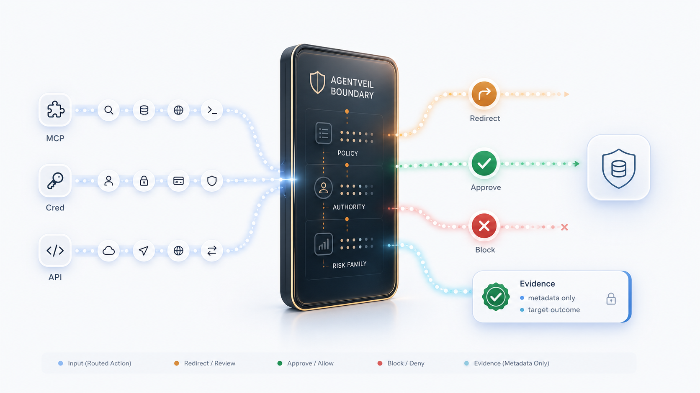

<div align="center">


# AgentVeil

[](https://pypi.org/project/agentveil-mcp-proxy/)
[](https://pypi.org/project/agentveil-mcp-proxy/)
[](https://github.com/agentveil-protocol/agentveil-sdk/actions)
[](LICENSING.md)
[](LICENSING.md)
[](https://glama.ai/mcp/servers/agentveil-protocol/avp-sdk)

**Stop risky AI agent actions. Not the work.**

Independent AI agent security. On configured routes, AgentVeil checks supported actions and applies policy: allow, request approval, provide redirect guidance to a controlled path, or block. Safe alternatives require an available controlled path. Works with Cursor, Claude Code, Codex, Gemini CLI, Hermes CLI, and MCP tools.

[Quick Start](#quick-start) · [Console](#start-from-the-console) · [The Loop](#the-agentveil-loop) · [Connectors](#connectors-available-today) · [Evidence](#bounded-evidence) · [Scope](#scope) · [Design Basis](#design-basis) · [Docs](docs/)

</div>

```bash
pip install agentveil-mcp-proxy
```

**Packages**: [agentveil-mcp-proxy](https://pypi.org/project/agentveil-mcp-proxy/) · [agentveil](https://pypi.org/project/agentveil/) | **Website**: [agentveil.dev](https://agentveil.dev) | **Console**: [agentveil.dev/console](https://agentveil.dev/console/auth) | **Plans**: [agentveil.dev/#pricing](https://agentveil.dev/#pricing) | **Package source**: [`packages/agentveil-mcp-proxy/`](packages/agentveil-mcp-proxy/)

> **Agent action boundary:** AI runtimes execute agents. AgentVeil mediates
> configured action paths around them. When a native or risky action hits the
> boundary, AgentVeil decides allow, approval required, redirect guidance toward
> a controlled path, or hard-block. Routed MCP calls follow the same decision
> model and record bounded local evidence.
>
> AgentVeil is not machine-wide control. Actions outside configured AgentVeil boundaries are not classified or logged.

<p align="center">
  
</p>

> **Visual overview:** request → AgentVeil boundary → redirect / approval / hard-block → local proof.
>
> **Data handling:** AgentVeil is designed to keep raw MCP arguments local by default and to record bounded metadata and hashes for evidence. See [Data Handling](docs/DATA_HANDLING.md).

## The AgentVeil Loop

AgentVeil is one product loop, not a pile of separate components:

| Step | What happens |
|---|---|
| Attempt | Agent tries a native mutation or routed MCP action in a configured project |
| Decision | AgentVeil returns allow, approval required, redirect, or hard-block |
| Controlled path | When one is available, redirect guidance tells the agent to retry through the managed MCP route |
| Proof | Bounded local evidence records the decision; inspect it with `events show --last` |

Approval fixes actions that need human review. Redirect tells the agent to
retry through the controlled MCP route when one is available. Hard-block means
approval will not help for that action. Local proof is available now through
the CLI. Console summaries complement those local records; they do not replace
local evidence export or offline verification.

## What AgentVeil Adds

AgentVeil is not an AI agent and does not replace an agent runtime. It adds a
control layer around actions that are configured to pass through AgentVeil.

| Layer | Agent runtime / framework | AgentVeil adds |
|---|---|---|
| Execution | Runs the agent and exposes tools | Mediates configured action paths before execution |
| Approval | May prompt per tool call, depending on runtime | Adds policy-aware approval for routed writes and mutations |
| Risk classification | Runtime-specific, if present | Shared read / write / destructive / unknown classification |
| Sandbox boundary | Runtime-specific | Project or downstream sandbox limits for routed actions |
| Evidence | Usually chat or runtime logs | Bounded local records with request ids, decisions, and hashes |
| Cross-runtime consistency | Per runtime | Same core control semantics where actions are routed through AgentVeil |

## Quick Start

Use AgentVeil with a supported project connector, or run the Core MCP Proxy directly.

### Start from the Console

Sign in at [agentveil.dev/console/auth](https://agentveil.dev/console/auth)
with GitHub or Google, pick your agent, and run the command the Console shows.
The same commands are listed below for each connector.

When you run a connector's `setup` command, AgentVeil opens the Console in your
browser so you can approve this machine. The Console then shows what your
connected projects report: project connection status, decision summaries and
approval summaries. Raw prompts, source code and file contents stay on your
machine in this connector-summary flow. This is not a blanket statement about
content supplied to hosted SDK/API workflows; see [Data Handling](docs/DATA_HANDLING.md).
Local connector and proxy control do not require Console pairing; backend-backed
SDK and Runtime Gate workflows have their own service requirements.

Successful connector setup and explicit status checks can also attempt browser
pairing and, for an eligible Console workspace, download and install an additional
local provider package. Availability depends on the workspace capability and
provider checks; installing the public proxy alone does not grant that capability.
See [the package's Console scope](packages/agentveil-mcp-proxy/README.md#connect-to-agentveil-console-optional)
for the distinction between pairing, reporting, and provider installation.

If the browser did not open (for example on a headless machine) or you closed
it, connect later:

```bash
agentveil-mcp-proxy login
```

`login` prints a verification URL and a short code (`--no-open` for headless
use); `agentveil-mcp-proxy logout` disconnects this machine. See
[Connect To AgentVeil Console](packages/agentveil-mcp-proxy/README.md#connect-to-agentveil-console-optional)
for the exact scope.

### Cursor project connector

```bash
pip install agentveil-mcp-proxy
agentveil-mcp-proxy setup cursor --choose-folder
```

Choose the project folder you want to protect, then reopen / reload Cursor for that project.

After setup, in the configured project:

- supported native risky agent actions can be blocked before execution;
- the agent receives redirect guidance toward the AgentVeil MCP route;
- routed MCP writes can require approval;
- AgentVeil records bounded local evidence for decisions and outcomes.

Some Cursor versions may require enabling the managed `agentveil-mcp-proxy` MCP server once in **Tools & MCPs** after reload.

### Claude Code project connector

```bash
pip install agentveil-mcp-proxy
agentveil-mcp-proxy setup claude-code --choose-folder --yes
```

Choose the project folder you want to protect, then reopen / reload Claude Code for that project.

After setup, in the configured project:

- supported native Claude Code mutation tools are checked by a project-local hook;
- risky native mutations are blocked with redirect guidance toward the controlled MCP route;
- AgentVeil MCP writes go through the proxy approval path;
- bounded evidence is written locally.

### Codex project connector

```bash
pip install agentveil-mcp-proxy
agentveil-mcp-proxy setup codex --choose-folder --yes
```

Choose the project folder you want to protect, then open / restart Codex for
that project. Codex asks you to trust the AgentVeil project hook once; until
the hook fires and evidence is observed, `setup status --client codex` remains
advisory, not protected.

After setup and hook trust, in the configured project:

- supported native Codex mutation tools are checked by a project-local hook;
- risky native mutations are blocked with redirect guidance toward the controlled MCP route;
- AgentVeil MCP writes go through the proxy approval path;
- bounded evidence is written locally.

### Gemini CLI project connector

```bash
pip install agentveil-mcp-proxy
agentveil-mcp-proxy setup gemini-cli --choose-folder --yes
```

Choose the project folder you want to protect, then open / restart Gemini CLI
for that project. Gemini CLI asks you to trust the project folder before it
loads local settings, hooks, and MCP servers.

After setup and folder trust, in the configured project:

- supported native Gemini CLI mutation tools are checked by a project-local hook;
- risky native mutations are blocked with redirect guidance toward the controlled MCP route;
- AgentVeil MCP writes go through the proxy approval path;
- bounded evidence is written locally.

### Hermes CLI controlled MCP profile

Hermes CLI is launched through AgentVeil rather than installed as a persistent
project hook:

```bash
pip install agentveil-mcp-proxy
agentveil-mcp-proxy launch --profile hermes-cli --choose-folder -- \
  hermes chat -q "Create a project note"
```

The launcher configures a project-local Hermes home, routes Hermes to the
AgentVeil MCP tools, and keeps local proof/evidence in the selected project.

In this profile:

- Hermes project work is routed through the AgentVeil MCP route;
- routed reads, writes, approval, sandbox boundaries, redirect guidance, and
  local proof use the shared AgentVeil control layer;
- native Hermes tools are limited by profile settings, but AgentVeil does not
  claim host-wide control of Hermes or the machine.

### Core MCP Proxy path

For lower-level MCP routing without an IDE connector (an alternative to the
connector setup above, not an additional required step after connector setup):

```bash
pip install agentveil-mcp-proxy
agentveil-mcp-proxy init --quickstart-filesystem ./sandbox
agentveil-mcp-proxy doctor --full
agentveil-mcp-proxy run
```

This starts the core route: MCP tool calls explicitly pointed at `agentveil-mcp-proxy`.
For manual identity registration, backend readiness and signer-pinned offline
verification, follow the [Core MCP Proxy quickstart](docs/MCP_PROXY_QUICKSTART.md).

### Verify your setup works

After installing a project connector, walk the current shipped path in that
project:

1. Ask the agent to read project context. Routed reads such as `list_workspace`,
   `read_file`, `get_file_info`, and `instruction_surface_status` should allow.
2. Ask the agent to create or edit a file, for example:

```text
Create avp-test.txt with the text hello
```

The configured connector should stop the native mutation with redirect
guidance; the agent should then use the controlled MCP route, where risky
writes require approval.
3. Open the approval page when prompted and review the bounded proof details.
4. Inspect local proof from the CLI:

```bash
agentveil-mcp-proxy events show --last
```

The default human output should include lines like
`decision=approval_required` and `tool=write_file` without dumping raw JSON.
Use `--json` when you need structured fields.

## Connectors Available Today

AgentVeil is built around action-control boundaries. Cursor, Claude Code,
Codex, and Gemini CLI are supported project hook connectors. Hermes CLI is
available as a controlled MCP launch profile. The Core MCP Proxy is
runtime-agnostic for MCP clients that are explicitly configured to call it.

| Surface | Mechanism | What it adds | Status |
|---|---|---|---|
| Cursor project connector | Project-local hooks + MCP route | Native mutation block + redirect guidance, routed MCP approval/evidence | Available |
| Claude Code project connector | Project-local `PreToolUse` hook + MCP route | Native mutation block + redirect guidance, routed MCP approval/evidence | Available |
| Codex project connector | Project-local `PreToolUse` hook + MCP route | Native mutation block after one-time hook trust, redirect guidance, routed MCP approval/evidence | Available |
| Gemini CLI project connector | Project-local `BeforeTool` hook + MCP route | Native mutation block after one-time folder trust, redirect guidance, routed MCP approval/evidence | Available |
| Hermes CLI profile | AgentVeil launcher + project-local Hermes MCP route | Routed MCP approval/evidence, sandbox boundaries, redirect guidance inside the AgentVeil route | Available |
| Core MCP Proxy | MCP transport boundary | Routed MCP policy, approval, redirect / policy-stop outcomes, bounded evidence | Available |

Here, **Available** identifies a shipped integration mechanism, not control of
unlisted client modes or a guarantee that a project's connection is active. Required
reloads, trust prompts, route configuration and observed hook evidence still
apply. Check the connector instructions above and local setup status.

The Python SDK also includes framework examples and optional helper modules for
CrewAI, LangGraph, AutoGen, PydanticAI, OpenAI, Gemini, and AWS Bedrock. Those
examples are not the same as a project connector: they show how agent workflows
can use AgentVeil primitives, while connector coverage still depends on what is
configured and routed through AgentVeil.

Future connectors can follow the same model: configure a boundary, route risky
actions through controlled tools, and record evidence.

## Compatibility

Current connector checks have been run with:

| Surface | Checked version |
|---|---|
| Cursor | 3.6.31 |
| Claude Code | 2.1.126 |
| Codex | interactive TUI hook trust path |
| Gemini CLI | 0.49.0 folder trust path |
| Hermes CLI | live controlled MCP route path |
| Python package metadata | Python 3.10-3.13 |

Compatibility is scoped to the versions and client paths listed here. It does
not establish support for other client modes or later releases. Python metadata
states the declared interpreter range; runtime checks remain environment-specific.
Where a row omits an exact version
or check date, it is not a version-pinned compatibility guarantee. For project
readiness, use the connector-specific instructions and local status.

Other versions may work, but are not listed here until verified.

## What AgentVeil Controls

AgentVeil has two public action-control surfaces:

1. **Project connectors**
   - configured per project/workspace;
   - install managed local hooks and MCP route config;
   - block supported native risky agent mutation tools;
   - return redirect guidance toward AgentVeil MCP tools;
   - use MCP Proxy approval and evidence for routed tool calls.

2. **Core MCP Proxy**
   - wraps downstream MCP servers;
   - classifies routed MCP tool calls;
   - returns allow / approval_required / redirect / policy-stop outcomes;
   - records bounded local evidence.

## What AgentVeil Does Not Control

AgentVeil does **not** claim machine-wide control.

It does not control:

- your whole machine;
- every Cursor / Claude / Codex / Gemini / Hermes chat globally;
- every autonomous agent runtime globally;
- direct human terminal commands outside configured AgentVeil paths;
- IDE actions outside supported agent tool surfaces;
- MCP servers not routed through AgentVeil;
- disabled, removed, or bypassed hooks;
- unsupported client modes that skip hooks.

Actions outside configured AgentVeil boundaries are not classified or logged.

## Bounded Evidence

AgentVeil records bounded local evidence for controlled actions, so you can
review what an agent requested, whether it was allowed, given redirect guidance,
sent for approval, returned a hard-block decision, and whether the controlled
path completed.

Inspect recent decisions:

```bash
agentveil-mcp-proxy events show --last
agentveil-mcp-proxy events show --last --json
```

Example evidence shape:

```json
{
  "tool": "write_file",
  "decision": "approval_required",
  "approval": "approved",
  "target_reached": true,
  "payload_hash": "sha256:...",
  "timestamp": "2026-06-25T..."
}
```

Evidence is designed for audit and incident review:

- what the agent requested;
- what policy decided;
- whether approval was required;
- whether the action executed;
- hashes and bounded metadata instead of raw prompts or full payloads by default.

This is useful for AI-agent governance, compliance review, and debugging unsafe automation.

## Handling False Positives

AgentVeil is designed to fail closed for risky actions. If a supported agent action is blocked unexpectedly, inspect local decision evidence before changing the setup.

Start with:

```bash
agentveil-mcp-proxy events show --last
agentveil-mcp-proxy setup status --json
```

For routed MCP actions, approval and policy behavior are documented in:

- [Approval Routing](docs/APPROVAL_ROUTING.md)
- [MCP Proxy Operations](docs/MCP_PROXY_OPERATIONS.md)

If a connector is not right for a project, remove only the managed AgentVeil
entries for that project instead of editing client config by hand.

Preview managed removal:

```bash
agentveil-mcp-proxy setup remove cursor
agentveil-mcp-proxy setup remove claude-code
agentveil-mcp-proxy setup remove codex
agentveil-mcp-proxy setup remove gemini-cli
```

Apply removal after review:

```bash
agentveil-mcp-proxy setup remove cursor --yes
agentveil-mcp-proxy setup remove claude-code --yes
agentveil-mcp-proxy setup remove codex --yes
agentveil-mcp-proxy setup remove gemini-cli --yes
```

## Scope

| Component | Availability and boundary |
|---|---|
| Public local packages | Project connectors, explicitly routed MCP calls and local evidence; Console pairing is optional. Backend-backed flows still need the configured backend. |
| Hosted Console | Device pairing and bounded connection/decision/approval summaries; visibility depends on what the connected project reports. |
| Additional local provider capabilities | Separate package, workspace eligibility and activation checks; they are not granted by installing the public proxy. See the [package scope](packages/agentveil-mcp-proxy/README.md#connect-to-agentveil-console-optional). |
| SDK primitives | APIs and examples for application-owned integrations, distinct from ready-to-use project connectors. |
| Preview / design-partner flows | The limited-release patterns listed below; they are not general public connector coverage. |

Available today:

- MCP Proxy for routed MCP tool calls;
- project-local Cursor connector;
- project-local Claude Code connector;
- project-local Codex connector;
- project-local Gemini CLI connector;
- Hermes CLI controlled MCP launch profile;
- approval / redirect / block / evidence outcomes for routed actions;
- bounded local evidence export.

Available as SDK / protocol primitives:

- capability-token primitives;
- local identity helpers;
- delegation receipts;
- proof packet helpers.

Preview / design-partner product flows:

- session-token flows for reducing repeated approvals;
- richer policy packs;
- credential custody;
- egress boundary;
- hosted approval and team governance.

Not included in the public connector:

- machine-wide shell interception;
- global Cursor / Claude / Codex / Gemini / Hermes lock;
- automatic control of unrelated chats;
- private enterprise policy packs;
- hosted service implementations for auth, licensing, telemetry, or enterprise
  custody. Public clients may still contain pairing, summary upload and provider
  installation code; this exclusion concerns the hosted implementation.

## Example Risk Patterns

AgentVeil is useful when an agent crosses from reading context into changing state.

| Workflow | Low-risk actions | Higher-risk actions AgentVeil can gate |
|---|---|---|
| Code / PR workflow | read files, inspect git history, list workspace | edit files, run mutation commands, change repo state |
| Content workflow | read drafts, inspect metadata | publish, send, update CMS-like content |
| Data workflow | read query results, inspect schemas | mutate records, export sensitive data, run destructive operations |
| Package / build workflow | inspect dependencies, read lockfiles | install packages, run scripts, change build output |

### Agentic media / broadcast workflows

Agentic media and broadcast workflows often start with read access to files, assets, CMS entries, Git history, or SQL query results, then cross into higher-risk writes and sends: publishing updates, changing a repository, mutating a database, or sending final content.

This is one example of the broader risk pattern:

```text
agent reads metadata        -> allow / observe
agent edits file or record  -> approval required
agent publishes or sends    -> approval / redirect
agent tries unsafe mutation -> block
agent action completes      -> bounded evidence
```

AgentVeil does not ship native broadcast, CMS, or SQL integrations in this package. The example describes the risk pattern for agentic workflows.

## Why This Exists

AI agents increasingly hold direct access to files, repositories, package managers, credentials, and workflow tools.

The risk is no longer only what an AI says. The risk is what an AI can do.

AgentVeil focuses on action control:

1. **Block unsafe native agent actions** in configured project connectors.
2. **Return redirect guidance** so the agent can retry through controlled MCP tools.
3. **Require approval** for routed writes and mutations.
4. **Record bounded evidence** for audit, review, and compliance.

AgentVeil does not solve the general access-control safety problem. It narrows the problem to configured projects, routed MCP calls, supported agent tool paths, and explicit policy decisions.

## Design Basis

The MCP Proxy design is summarized in
[MCP Proxy Design Principles](docs/MCP_PROXY_DESIGN_PRINCIPLES.md).

- Fail-safe defaults: missing policy, missing approval, or unavailable trusted decisions move toward denial or explicit review.
- Complete mediation on routed calls: each protected downstream MCP call goes through the same classify, decide, evidence, and forward-or-deny path.
- Least privilege: approvals are scoped to concrete action context instead of broad standing permission.
- Separation of privilege: local proxy identity, control grants, and backend signing authority are separate roles.
- Bounded evidence: receipts, payload hashes, and local evidence chains bind decisions to the routed action subset.

For deeper security framing, including Saltzer & Schroeder and HRU-aware limits, see [MCP Proxy Design Principles](docs/MCP_PROXY_DESIGN_PRINCIPLES.md).

## Comparison

| Category | Main focus | Where AgentVeil differs |
|---|---|---|
| Prompt/content guardrails | Detect unsafe text | AgentVeil controls actions and tool calls, not only prompts |
| LLM API gateways | Route model traffic | AgentVeil mediates agent tool execution and evidence |
| Direct MCP servers | Expose tools to agents | AgentVeil adds policy, approval, redirect, and evidence between agent and tool when routed through the proxy |
| Secret managers | Store credentials | AgentVeil controls when risky agent actions may execute |
| Generic audit logs | Record app events | AgentVeil binds evidence to specific agent action requests and decisions |

## Reporting Issues And Security Findings

For bugs and integration problems, use the repository issue tracker. For security-sensitive findings, follow the repository [Security Policy](SECURITY.md).

Security-sensitive reports should not include secrets, raw credentials, private keys, or full customer data in public issues.

## Licensing

The root SDK is MIT-licensed.

`agentveil-mcp-proxy` is a separately packaged source-available component under BUSL-1.1. See [Licensing](LICENSING.md) before using it in commercial or competing hosted services.

**Hosted Console and plans.** Local connector and proxy control do not require
Console pairing. Hosted services and additional capabilities have their own
availability and terms; see [plans and pricing](https://agentveil.dev/#pricing).
A software license describes rights to the package, not a hosted subscription
or entitlement.

## Python SDK and advanced protocol primitives

Advanced Python SDK package: `agentveil`.

The public SDK also includes protocol primitives that can support custom integrations: local `did:key` identity, delegation receipts, credential helpers, reputation credential access, receipt helpers, and optional framework adapter modules under `agentveil.tools.*` when their framework dependencies are installed.

These primitives are not the main product path in this README. For direct use, start with:

- [Agent Network (Advanced)](docs/ADVANCED_AGENT_NETWORK.md)
- [DelegationReceipt Guide](docs/DELEGATION_RECEIPT.md)
- [Proof Packet Guide](docs/PROOF_PACKET.md)
